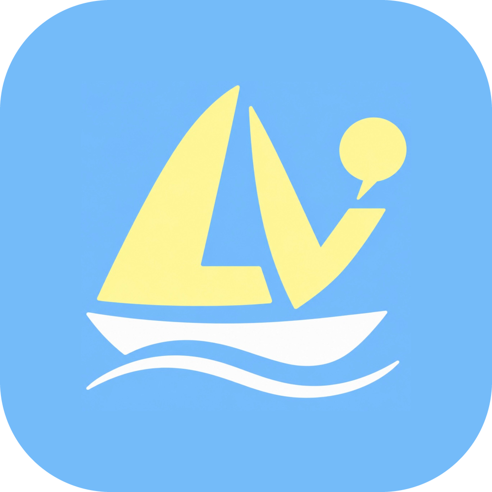

# Lingvoyage

**Language + voyage.** Lingvoyage helps travelers learn the language of the country they're visiting. The first target language is **Mandarin Chinese**, taught in English.

The core feature is **Encounters**: pick a travel scene (arriving at the airport in Chengdu, ordering noodles in Beijing, asking for your train in Shanghai, checking in to a hotel in Chengdu) and hold a spoken or typed conversation with an AI character who answers out loud in Mandarin. Every reply comes with pinyin, an optional English translation, feedback on what you said, and suggestions for what to say next.

Before a scene, learners can take optional **practice lessons**: short quizzes (multiple choice and word tiles, with hints) on the sentence patterns and words the scene uses. The character then speaks with those same patterns, so the encounter matches what was practiced.

## How it fits together

```
iPhone (Expo Go)
  ├── Supabase Auth ......... sign up / log in, profile, progress
  └── Lingvoyage API (FastAPI) .. runs on your PC now, AWS Lambda later
         ├── ElevenLabs Speech-to-Text (Scribe v2)
         ├── Claude API (Haiku 5.5)
         └── ElevenLabs Text-to-Speech (Flash v2.5)
```

See `docs/architecture.png` for the diagram.

| Folder | What's in it |
|---|---|
| `mobile/` | Expo SDK 57 app (Expo Router, TypeScript) |
| `backend/` | FastAPI app (Python 3.13), runs locally with uvicorn and on AWS Lambda via Mangum |
| `docs/` | Setup guides, architecture diagram, build prompt |

## Quickstart

Follow the guides in [`docs/setup/`](docs/setup/00-START-HERE.md) in order. In short:

1. Install the tools and Expo Go ([01](docs/setup/01-windows-dev-environment.md)).
2. Create the Supabase, ElevenLabs and Claude accounts and keys ([02](docs/setup/02-supabase.md), [03](docs/setup/03-elevenlabs.md), [04](docs/setup/04-claude-api.md)).
3. Fill in `mobile/.env` and `backend/.env` ([05](docs/setup/05-environment-variables.md)).
4. Start the backend and the app, then open it on your iPhone ([06](docs/setup/06-run-on-your-iphone.md)).
5. Deploy the backend to AWS Lambda before the demo ([07](docs/setup/07-aws-deploy.md)).

Something broken? See [08-troubleshooting](docs/setup/08-troubleshooting.md).
